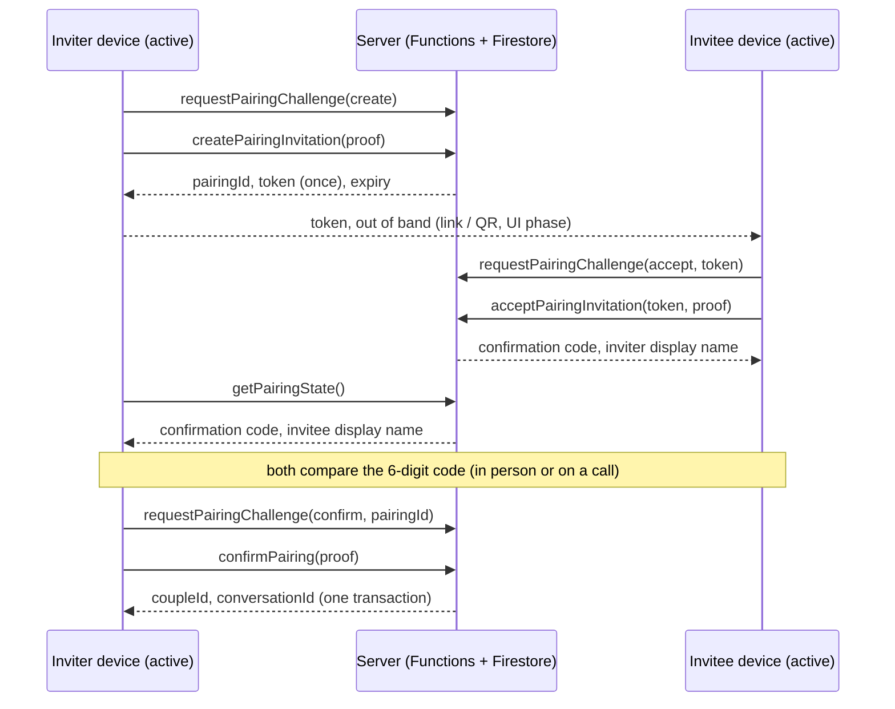
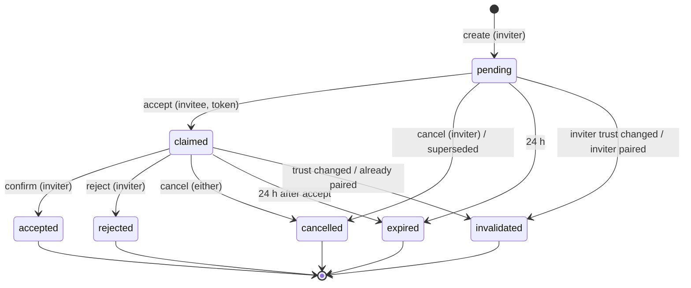

# Couple and Pairing

Status: **Implemented (Prompt 12) as server logic, rules and a client service;
emulator-tested; NOT deployed (Functions need Blaze, D-025); no UI; not
reviewed.** Decisions D-100–D-105. Sirf Hum is NOT production E2EE, and this
design has had no independent review.

This document refines the Prompt 04 sketch in
[PAIRING-AND-DEVICE-TRUST](PAIRING-AND-DEVICE-TRUST.md#pairing-two-people-recommended).
It reuses the device trust model of
[DEVICE-IDENTITY](DEVICE-IDENTITY.md) and [MULTI-DEVICE-TRUST](MULTI-DEVICE-TRUST.md),
and the conversation provisioning of
[E2EE-MESSAGING-DESIGN §3](E2EE-MESSAGING-DESIGN.md#3-couple-and-conversation-authority-d-086).

## 1. Model (D-100)

```text
Account (Firebase Auth UID — the only account identifier)
  ├── profile users/{uid}: display name only
  ├── trusted devices users/{uid}/devices/*  (Prompts 07–09, unchanged)
  └── at most ONE active couple in V1
        couples/{coupleId}: exactly two accounts
          └── the couple's conversation conversations/{id} (Prompt 10)
```

| Concept | Identifier | Authority |
| --- | --- | --- |
| Account | Firebase Auth UID | Firebase Auth; never a cryptographic identity |
| Profile | `users/{uid}` | Owner writes (rules-validated); carries **no** authority |
| Device | 16-byte device ID + certificate | Server activation + signed evidence (D-069–D-084) |
| Pairing | `pairings/{pairingId}` (16 random bytes) | Server only, through signed callables |
| Couple | `couples/{coupleId}` (16 random bytes) | Server only, created by the confirmation transaction |
| Conversation | `conversations/{id}` (16 random bytes = MLS group ID) | Server only (D-086) |

- **Couple membership is never inferred from Firebase Auth.** It exists only
  because two accounts each completed a signed step (§3), and it is stored
  only by the server.
- **Couple membership ≠ unlimited access.** It grants exactly what the
  existing rules allow: the partner's profile, device directory and
  `accountTrust` (public material), and the couple's conversation
  ciphertext. It grants nothing over the partner's account, devices or keys.
- **Firebase password ≠ device trust.** Every pairing step needs a proof from
  an active device's key (§3, D-102).

## 2. Pairing protocol (D-101)

Three signed steps. Both consents are explicit: the invitee accepts the
invitation, and the inviter then confirms *that specific account*. A bearer
link alone never pairs anyone.



- **Token:** 16 random bytes from the server's CSPRNG, base64url (22 chars).
  It is returned once, to the inviter. The server stores only
  `SHA-256("SirfHum-PairingToken-v1|" + token)` and deletes even that hash on
  redemption, cancellation, expiry or invalidation. *Deviation from Prompt 04*
  (which had the device generate it): server generation guarantees entropy.
  The token is an authorization secret, not a key: it grants only the right
  to *propose* oneself to the inviter.
- **Confirmation code:** 6 random digits, generated at acceptance. It is shown
  to both participants and deleted on confirmation. It is a human check that
  the person who accepted is the person invited. It is **not** cryptographic
  verification: partner PIK verification (safety numbers) is a separate,
  later step (§8).
- **Display names** are revealed only to the other participant, and only
  after the invitee has accepted. Nothing reveals whether a token, account or
  pairing exists to anyone else (§6).
- **Lifetimes (server clock only):**
  - an invitation lasts 24 h;
  - after acceptance the inviter has 24 h to confirm;
  - step challenges last 5 min.

  Clients receive these times for display only and never send times.

## 3. Device trust for every step (D-102)

Each step is `requestPairingChallenge` → a device-key proof → the step.

- The challenge is single-use, stored server-side in `deviceChallenges` with
  `purpose: 'pairing'`, the step and `binding =
  SHA-256("SirfHum-PairingStep-v1|" + step + "|" + subject)`. The subject is
  empty for `create`, the token hash for `accept`, and the pairing ID for
  `confirm`/`reject`/`cancel`. A challenge for one step or subject is useless
  for any other.
- The proof is the D-070 device proof with the **new purpose `pairing` = 4**,
  a separate signed domain, so a proof made for activation, enrollment or a
  push token is never a pairing proof, and vice versa. The new value adds
  one accepted value to `ProofPurpose` (Rust, Dart, TS). It changes no
  format or function, and the ABI stays v6.
- The server verifies the proof against the device's **stored** certificate
  and requires `status == 'active'` in the same transaction as the step. A
  device revoked between its challenge and its step is refused.
- Failed proofs count toward the existing `verificationFailure` budget (D-077).

**Fail closed on trust changes.** The pairing records each participant's
`identityEpoch` (D-082) and bound device. The step that would advance it
moves it to `invalidated` instead when any of these holds:

- either account has a **pending identity reset**;
- either account's identity epoch changed (a **completed reset**);
- the inviter's creating device or the invitee's accepting device is **no
  longer active** (revoked, or any other status);
- either account is **already paired**.

## 4. State machine (D-101)



| From \ To | claimed | accepted | rejected | cancelled | expired | invalidated |
| --- | --- | --- | --- | --- | --- | --- |
| `pending` | ✅ invitee `accept` | ❌ (no couple without the invitee) | ❌ | ✅ inviter `cancel`; `superseded` | ✅ | ✅ |
| `claimed` | ❌ | ✅ inviter `confirm` | ✅ inviter `reject` | ✅ inviter or invitee `cancel` | ✅ | ✅ |
| terminal (`accepted`, `rejected`, `cancelled`, `expired`, `invalidated`) | ❌ | ❌ | ❌ | ❌ | ❌ | ❌ |

- Nothing ever returns to `pending` or `claimed`; a new attempt is a new
  pairing with a new token.
- The table is code (`functions/src/couple/state.ts`, `TRANSITIONS`). Every
  status write calls `assertTransition`. An illegal move is an internal
  error, never a client category, and an exhaustive unit test pins the
  matrix.
- Expiry is **lazy and server-authoritative**: the step or read that meets an
  open pairing past its deadline treats it as expired, and a transaction
  records `expired`.
- **Superseded:** accepting someone else's invitation cancels the acceptor's
  own *unredeemed* invitation in the same transaction. An invitation that
  someone has already accepted is never silently replaced
  (`pairing_in_progress`).
- **Idempotency:**
  - a retried `confirm` (lost acknowledgement) returns the same couple;
  - a retried `cancel` or `reject` succeeds without change.

**Couple lifecycle:** `active` only in V1. Dissolution (unpairing) is deferred
(D-105): it needs the shared-history decision (open decision 6), MLS removal
and rules for a dissolved conversation. No client or server path changes a
couple today.

## 5. Schema

| Path | Fields | Client access |
| --- | --- | --- |
| `users/{uid}` | `schemaVersion: 1`, `displayName` (1–64 chars, not blank, no control characters), `createdAt`, `updatedAt` (both `request.time`) | Owner: create, update `displayName` + `updatedAt` only. Owner and partner: read. Nobody deletes or lists |
| `pairings/{pairingId}` | `schemaVersion`, `status`, `inviterAccountId`, `inviterDeviceId`, `inviterIdentityEpoch`, `tokenHash` (while `pending`), `createdAt`, `expiresAt`; after accept: `inviteeAccountId`, `inviteeDeviceId`, `inviteeIdentityEpoch`, `claimedAt`, `confirmExpiresAt`, `confirmationCode` (while `claimed`); after confirm: `accounts` (D-086 contract), `acceptedAt`, `confirmedByDeviceId`, `coupleId`, `conversationId`; when ended: `endReason`, `endedAt`, `endedByDeviceId` | **None** |
| `pairingLocks/{uid}` | `pairingId`, `role` (`inviter`/`invitee`) | **None** |
| `couples/{coupleId}` | `schemaVersion: 1`, `members` (two sorted UIDs), `status: 'active'`, `pairingId`, `createdAt` | Members: read. Nobody writes |
| `accountPartners/{uid}` | Prompt 10 fields + `coupleId` | Owner: read (unchanged) |
| `conversations/{id}` | Prompt 10 fields + `coupleId` | Unchanged (D-086 rules) |

- **Pairing locks** serialize pairing per account: each step reads and writes
  both participants' locks in its transaction. A lock is a hint, always
  checked against the pairing it names, so a lock left behind by an expired or
  ended pairing never blocks anyone.
- **`accountPartners`** remains the one-couple-per-account index (D-086).
- Server timestamps only.
- **Audit evidence:** the pairing record is the audit trail. It keeps the
  acting device IDs, server timestamps and an end reason, is server-only and
  holds no secrets once ended. Logs carry the event and an outcome category
  only (§7).

## 6. Authorization and enumeration resistance (D-103)

The server derives the account from the verified Firebase auth context. It
never accepts these from a client: inviter or invitee UIDs, couple IDs,
membership, statuses, timestamps, or authorization decisions. Inputs are
`deviceId`, `challengeId`, `proof`, and the step's `token` or `pairingId`,
all pattern-checked. Unknown fields are ignored (tested).

| Check | Result |
| --- | --- |
| Token unknown, used, expired, cancelled, own, or inviter unable to pair | the same `invitation_invalid` |
| Pairing unknown, or the caller is not its participant | the same `pairing_not_found` |
| Account lookup by UID, email or name | **no such function**; no client can list `users`, `couples` or `pairings` |
| Token guessing | 128-bit tokens; `pairingRedeemFailure` 10/h per account, checked before the challenge |
| Volume | `pairing` (step challenges) 30/h; `pairingInvitation` 10/24 h per account |

**Races.** Every transition is one Firestore transaction over the pairing,
both locks, both partner records, both trust records and the bound devices.
The emulator tests cover:

- concurrent accepts of one token: exactly one wins;
- concurrent creates by one account: exactly one;
- two people accepting each other's invitations at once: one pairing;
- concurrent confirms: one couple;
- confirm racing a withdrawal: consistent either way;
- confirm racing an identity reset: never a couple with a reset account
  once the reset commits first.

## 7. Privacy (D-100)

- **Stored:** a display name, the pairing record, the couple record. All are
  relationship metadata, sensitive because they reveal that two accounts are
  a couple, and all are server-only or visible only to the two people.
- **Not stored or collected:** email, phone, contacts or address books,
  location, presence, last seen, activity, relationship scoring, or any
  content. The confirmation code and the token hash are deleted once they
  are no longer needed.
- **Never logged:**
  - tokens, codes, account IDs, device IDs and names;
  - in Functions, the pairing module has no logger, and the callable wrapper
    logs `{outcome}` only (static guard tests);
  - in Dart, `pairing_step` logs carry the step and outcome category only
    (tested).
- **Retention:** ended pairing records are kept as audit evidence. A
  retention and deletion policy is deferred with account deletion (D-105).

## 8. Binding to MLS conversations (D-104)

- **Atomic:** `confirmPairing` creates the couple **and** calls Prompt 10's
  provisioning, through the extracted `writeCoupleConversation`, in the
  **same transaction**. A couple without its conversation, or the reverse,
  cannot exist. `provisionConversation` itself is unchanged and is still not
  a callable.
- **Direction:** the conversation references the couple (`coupleId`); the
  couple does not list conversations. V1 has exactly one couple conversation,
  found through `accountPartners/{uid}.conversationId`. A future
  conversation (e.g. a separate thread) can reference the same `coupleId`
  without changing the couple schema. MLS group membership remains devices,
  decided by MLS and lineage verification (D-085), not by the couple record.
- **Not cryptographic trust:** the couple record authorizes *server access*
  (rules). Partners still verify each other's device lineage and PIKs on
  device (D-084, D-085). Out-of-band PIK verification (safety numbers) is
  still unresolved (PAIRING-AND-DEVICE-TRUST, "Verification") and belongs to
  the pairing UX.
- **No crypto changes:** MLS, Prompt 10/11 formats, the ABI version and the
  crypto pins are unchanged. The only crypto-core change is the additive
  proof purpose 4 (§3).

## 9. Threats

E47–E60 in [THREAT-MODEL](THREAT-MODEL.md). In short:

| Threat | Mitigation | Test |
| --- | --- | --- |
| Stolen session or password pairs, accepts or confirms | Device-key proof for every step | `a password alone cannot pair` |
| Stranger pairs with an inviter without consent (intercepted link) | Inviter confirms the specific account; comparison code; reject | `rejects the account that accepted` |
| Pairing someone without their consent | Only the token holder can accept; the invitee's own device signs | flows |
| Replay of token or challenge | Hash deleted on redemption; challenges single-use and bound | `a token redeems once…`, `bound to one step…` |
| Expired or stale requests | Server-clock deadlines; lazy expiry; locks re-validated | expiry tests |
| Concurrent accepts, invites, confirms | Single transactions over locks and records | concurrency tests |
| Already-paired account | `accountPartners` checked in every step | `a paired account cannot…` |
| Revoked device creates, accepts or confirms | Active status checked in-transaction; bound devices re-checked | revoked-device tests |
| Identity reset during pairing | Pending reset refused; epoch change invalidates | reset tests |
| Direct Firestore writes or forged membership | Rules deny all client writes to pairings, locks, couples, partners | `couple.test.js` |
| Account enumeration | Uniform categories; no lookup; no listing | enumeration tests |
| Clock disagreement | Server clock only; client times never accepted | expiry and forged-input tests |

## 10. Not done / deferred (D-105)

- **Deployment:** the callables need Functions (Blaze, D-025). Until then
  pairing runs only in the emulator, so no real couple can form.
- **UI:**
  - links or QR for the token;
  - the code comparison screen;
  - profile editing;
  - partner verification (safety numbers).
- **Unpairing / couple dissolution:** a unilateral, instant unpair is
  required (PAIRING-AND-DEVICE-TRUST, abuse considerations). It is blocked on
  open decision 6 (shared history), MLS removal and rules for dissolved
  conversations.
- **Account deletion or disablement:** the existing model has no deletion
  flow. A disabled Firebase account keeps a valid ID token for up to 1 h, but
  every pairing step still needs an active device proof. A deletion flow must
  end open pairings and dissolve the couple.
- **Notifications** for pairing events (content-free, D-097 style).
- **Retention** of ended pairing records.
- **Independent review** of this design and its implementation.

## Prompt 17B: the inviter enters the code (D-131)

The six-digit code is shown **only on the invitee's phone**.
`getPairingState` no longer returns it to the inviter, and `confirmPairing`
requires `confirmationCode`: the code the invitee reads out, compared in
constant time. A wrong code returns `confirmation_code_invalid`; the third
ends the pairing (`invalidated`, reason `confirmation_code_mismatch`). An
intercepted link therefore pairs a stranger only if the inviter types the
stranger's code. The partner's identity itself is verified afterwards with
the safety number (D-128).
