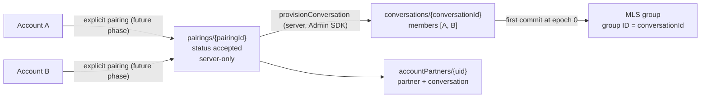
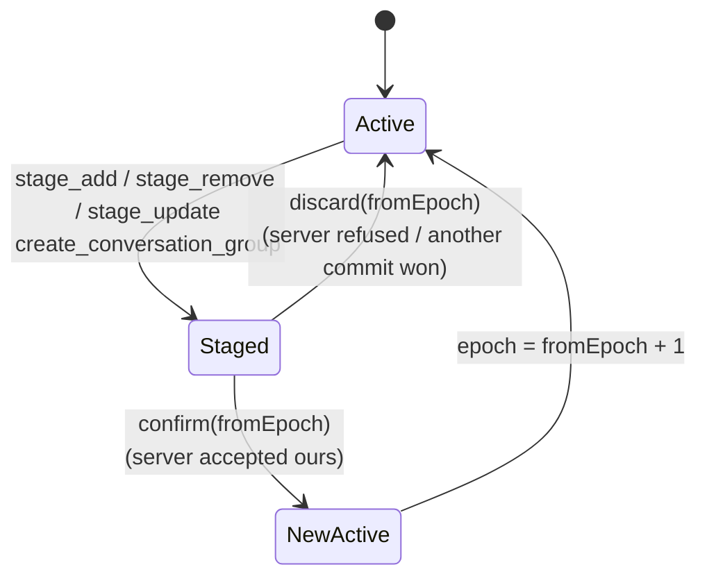

# E2EE Messaging Design (Prompt 10, Part 1)

Status: **Design gate for the messaging core. Implemented and tested in the
development environment only. Sirf Hum is NOT production E2EE.** Nothing
here has had an independent review. Deployment of the server parts is
**BLOCKED** (Blaze not enabled, D-025), and the pairing phase that creates
couples does not exist yet.

Decisions: D-085 to D-091 in the [Decision Log](../decisions/DECISION-LOG.md).
Builds on [CRYPTO-CORE-ARCHITECTURE](CRYPTO-CORE-ARCHITECTURE.md),
[MULTI-DEVICE-TRUST](MULTI-DEVICE-TRUST.md) and
[E2EE-ARCHITECTURE](E2EE-ARCHITECTURE.md) §5–§6.

Scope: **text messages only**, one conversation per couple. No media, no
notifications, no chat UI (a test harness only).

## 1. Vocabulary

| Term | What it is | Identifier | Authority |
| --- | --- | --- | --- |
| Account | A signed-in person (Firebase Auth) | `uid` | Firebase Auth. Grants server *access* only, never device or cryptographic trust |
| Device | One installation's identity for one account | `deviceId` (16 random bytes, hex on the server) | Created in the Rust core; activated by the server (D-069, D-075) |
| Trusted device | §2 | `(deviceId, certificate)` | The device's own verification of signed lineage |
| Couple relationship | Two accounts that both agreed to pair | `pairingId` | Server, written by the future pairing phase (§3) |
| Conversation | The couple's single private conversation | `conversationId` (16 random bytes, server-generated) | Server, from an accepted pairing only (D-086) |
| MLS group | The cryptographic state of the conversation; members are **devices** | MLS group ID **=** `conversationId` bytes | OpenMLS; validated by every member |
| Epoch | MLS group epoch; advances by one per accepted commit | integer | MLS; the server orders commits (§5) |
| Message | One text message | `messageId` (16 random bytes, generated in Rust) | Sender device |
| Envelope | The server-visible record of one message (§6) | the message document | Sender writes, rules validate |

A Firebase UID is an application identity. It is never a cryptographic
identity: no key, credential or MLS identity is derived from it.

## 2. Device trust binding (D-085)

### The gap being closed

Until Prompt 10 the core trusted **person keys** (PIKs) and blocked
**device IDs**. Since D-074 every device has its own PIK, and a PIK can
sign any number of certificates. So a revoked device that still holds its
PIK could sign a certificate for a *new* device ID, and that certificate
passed validation (trusted PIK, unrevoked ID).

### The trust unit

The core now trusts **exact device certificates**, not person keys:

```text
TrustedDevice = exact certificate bytes        (person key + device ID +
                                                device signature key + issued-at,
                                                signed by the person key)
              + source  (own | approved | anchor | lineage of account X)
              ∉ revoked devices, and its person key ∉ revoked person keys
```

The `TrustPolicy` in the Rust core holds:

| Field | Meaning |
| --- | --- |
| `anchors` | Person keys verified out of band (own PIK, `trustVerifiedPersonKey`). An anchor is a **root of trust for lineage**, never a blanket "trust anything this key signs" |
| `devices` | `deviceId → exact certificate + source (+ account for lineage)` |
| `pinned` | `personKey → deviceId`: each PIK certifies exactly **one** device (D-074) |
| `revoked_devices`, `revoked_people` | Permanent; revoking a device also revokes its PIK |
| `lineage_epochs` | Per account, the highest server trust epoch whose lineage was applied |

**Validation of every MLS credential** (Welcome roster, KeyPackage, commit
adds/updates/path, message sender), in order:

1. Basic credential; strict certificate decode; certificate signature.
2. Device ID not revoked; person key not revoked.
3. The device is in `devices` with **byte-identical** certificate bytes, **or**
   its person key is an anchor whose pin is free or already this device
   (the anchor's own root device; the pin is recorded).
4. A PIK pinned to a different device ID is refused.
5. The leaf signature key equals the certified device key.

Any failure is `unauthorized_device` / `invalid_credential` and rolls back.

**How devices become trusted:**

| Path | API | Effect |
| --- | --- | --- |
| Own device | identity creation / load | own certificate, own PIK anchored and pinned |
| Approval (D-075) | `approveDevice` (ABI v3) | the approver trusts the approved certificate and pins its PIK |
| Out-of-band anchor | `trustVerifiedPersonKey` (ABI v1) | PIK becomes an anchor; its first certificate is pinned |
| **Lineage (new)** | `trustLineage(lineage, trustEpoch)` (ABI v5) | verifies the account's signed chain (D-084); the root's PIK **must** be an anchor; every proven certificate becomes trusted for that account; signed and server-asserted revocations revoke the device **and** its PIK; devices of that account no longer proven are dropped; an older `trustEpoch` than already applied is refused (`trust_state_stale`) |

**Invariant (tested):** a revoked device cannot manufacture a trusted
device. A new device ID under its PIK fails (revoked PIK, and the pin), as
does reusing its old certificate (revoked ID), a forged certificate, a
lineage link it signs after revocation, and a stale lineage.

**Open (recorded in D-085):** a non-root device of an account must anchor
its own account's root PIK before it can verify its own lineage. Today that
is the same explicit `trustVerifiedPersonKey` call a partner uses; the
device-management/pairing UX must provide the verification step. Until then
it is development-only.

## 3. Couple and conversation authority (D-086)



- Clients **cannot** create or modify `pairings`, `conversations` (except
  the epoch counter, §5), or `accountPartners`. Rules deny it (tested).
- `provisionConversation(db, pairingId, now)` (Functions,
  `functions/src/conversation/provision.ts`) is a **server-internal
  primitive, not a callable**. It requires a `pairings/{pairingId}` record
  with `status: 'accepted'` and two distinct valid accounts. It is
  idempotent and transactional. It writes the conversation, the two
  `accountPartners` records and links the pairing.
- **Nothing in the product creates pairings yet**, so no ordinary client can
  reach provisioning. Tests seed a pairing with the Admin SDK to stand in
  for the future pairing phase. That is test scaffolding, not a fake couple
  in product code.
- `accountPartners/{uid}` lets each partner read the other's device
  directory and `accountTrust` (public material), which lineage
  verification needs. Reads only; no writes.
- One conversation per couple. MLS can hold up to 16 devices
  (`MAX_GROUP_MEMBERS`), so more people or devices later need no protocol
  rewrite, but V1 offers no group chats.

Deferred: pairing UX and invites, partner out-of-band verification UX,
unpairing (it must stop provisioning and remove devices), conversation
retirement.

## 4. ABI v5: staged commits (D-087)

ABI v4 functions keep their meaning (`add_member`, `remove_member`,
`self_update` merge immediately) for the existing regression suites.
Messaging uses only the staged functions.



| Rule | Behaviour |
| --- | --- |
| Staging | Produces the commit (and Welcome for adds); the active epoch does **not** change. The staged commit is persisted (sealed) and survives restart |
| One at a time | Staging, sending, ABI v4 membership calls and processing another member's commit are refused with `commit_pending` (-22) while a commit is staged. Processing application messages is allowed (§5) |
| Confirm | Atomic merge; returns the new epoch. Must name the epoch it was staged at |
| Duplicate confirm | Idempotent: same epoch, nothing staged, last confirmed = that epoch → returns the current epoch |
| Confirm after discard / reject / wrong epoch | `no_staged_commit` (-23); state unchanged |
| Confirm after timeout | The client reads `commits/{epoch}`: ours → confirm; someone else's → discard, then process theirs; absent → discard (commits are written in Firestore **transactions**, which never land later from the SDK's offline queue) and stage again if still needed |
| Concurrent commit | Server picks one (§5); the loser discards and processes the winner |
| Stale epoch | A staged commit names its epoch; confirm with any other epoch fails |
| Wrong conversation | `unknown_group` |
| Corrupted staged state | It lives in the sealed MLS state record: AEAD failure → `state_corruption`, the core refuses to open |
| Crash while staged / restart | The staged commit is reloaded; the client resolves it as for a timeout |
| Group creation | `create_conversation_group(conversationId, keyPackages)` creates the group (group ID = conversation ID) **and** stages the first add. Discarding it deletes the local group (an unconfirmed epoch-0 group means nothing) |

## 5. First commit wins (D-088)

`conversations/{c}/commits/{epoch}` is **create-only**, keyed by the epoch
the commit was made from. It is written in one batch with the
conversation's `epoch` counter moving from `epoch` to `epoch + 1` and the
commit's Welcomes. Rules check each half against the other (`getAfter`,
`existsAfter`).

| Server (rules) decides | MLS (every device) decides |
| --- | --- |
| The writer is a conversation member using an `active` device of their own account | The commit is well-formed, signed by a current member, and its adds/updates carry trusted credentials (§2) |
| The commit is for the conversation's **current** epoch | The resulting roster and epoch secrets |
| Exactly one commit per epoch (document exists → second write refused) | Whether to accept it at all: a cryptographically invalid winning commit is **rejected by every device** (fail closed; the conversation then needs re-provisioning, see limitations) |
| Welcomes only alongside the accepted commit | Joining from a Welcome, validating every member |

The server never decrypts, parses or validates MLS bytes. Clients write
commits and messages in Firestore transactions, never through the SDK's
offline queue, so a write the client treated as refused cannot land later.
Rules do not check a Welcome's target device: a Welcome is useless to anyone
but the holder of the matching KeyPackage key, and MLS validates the roster.

```mermaid
sequenceDiagram
    participant A as Device A1 (Rust core)
    participant S as Firestore (rules)
    participant B as Device B1 (Rust core)
    A->>A: send_message: roster all trusted? AAD(conv, id, sender, versions); encrypt; seal history (queued)
    A->>S: transaction: create messages/{id} (epoch == conversation.epoch, active device)
    S-->>A: accepted → mark_message_sent
    B->>S: read commits/L, then messages where epoch == L
    B->>B: sender account == lineage account? receive_message: MLS verify + decrypt; AAD == envelope; seal history
    Note over B: any mismatch rolls back; the key is not consumed
```

**Messages are written only at the current epoch** (rules: message
`epoch == conversation.epoch`). Combined with the commit rule this gives the
receive order (§8).

## 6. Message envelope and authenticated data (D-089)

### Firestore document `conversations/{c}/messages/{messageId}`

| Field | Visible to server | Authenticated (MLS) | Encrypted | Notes |
| --- | --- | --- | --- | --- |
| `messageId` (doc ID, 32 hex) | yes | **yes** (AAD) | no | 16 random bytes generated in Rust (OS CSPRNG); never derived from content |
| `conversationId` (path) | yes | **yes** (AAD and MLS group ID) | no | |
| `schemaVersion` = 1 | yes | **yes** (AAD) | no | Firestore schema of this document |
| `protocolVersion` = 1 | yes | **yes** (AAD) | no | Sirf Hum message protocol (AAD and payload format) |
| `senderDeviceId` (hex) | yes | **yes** (AAD, checked against the sender's validated credential) | no | Rules: an `active` device of `senderAccountId` |
| `senderAccountId` | yes | no (rules: `== auth.uid`) | no | The receiver checks it against the account its verified lineage assigns to `senderDeviceId`; a mismatch fails closed |
| `epoch` | yes | **yes** (MLS framing) | no | Rules: the current conversation epoch |
| `ciphertext` (bytes ≤ 32 KiB) | yes (opaque) | yes | **yes** | MLS `PrivateMessage` |
| `serverTime` | yes | no | no | `request.time`; transport ordering and display only |
| sender leaf, generation | no | yes | **yes** (sender data) | MLS-internal |
| text, client time, kind | no | yes | **yes** | the payload (below) |

**AAD** (MLS `authenticated_data`, built inside Rust; the caller cannot
choose it):

```text
"SirfHum-MessageAAD" | aad version u8 = 1 | schema version u16 | protocol version u16
| conversation id[16] | message id[16] | sender device id[16]
```

MLS sends this AAD in clear inside the `PrivateMessage` and authenticates it
(AEAD and signature), so it reveals nothing the envelope does not already
show. On receipt, Rust rebuilds it from the **envelope fields it was given**
and compares it with the authenticated AAD after MLS verification, all
inside one rollback transaction:

- envelope moved to another conversation → MLS group ID ≠ conversation:
  `envelope_mismatch` (-25);
- changed message ID, sender device, schema or protocol version →
  `envelope_mismatch`;
- changed epoch → `envelope_mismatch`;
- AAD or ciphertext bytes edited → `authentication_failure`;
- AAD sender ≠ the device whose credential signed → `envelope_mismatch`.

A rejected message never consumes the key (rollback), so the genuine
message still decrypts.

**Payload (encrypted):** `version u8 = 1 | kind u8 (1 = text) | client time
ms u64 | u32 len | UTF-8 text`. Media kinds later reuse the same envelope
with a `media_ref` kind (Prompt 11).

## 7. Local encrypted history (D-090)

- Every message (sent and received) is a sealed record in the **existing**
  per-account slot directory, sealed by the slot's platform store key
  (record kind 5, `msg_<conversation>_<message>`; the name is in the AEAD
  associated data, so records cannot be swapped). The Dart layer never
  writes message content to disk.
- **Atomicity:** the core writes the history record inside the same
  checkpoint as the MLS state change. A crash leaves either the old state
  (the message is reprocessed and the record overwritten) or both.
- **No plaintext fallback:** if sealing or writing fails, the operation
  fails (`persistence_failure`) and rolls back. Nothing is written in the
  clear, ever.
- Outgoing messages keep their ciphertext in the record until the server
  accepts them (the outbox). After that only the payload is kept.

| Situation | Behaviour |
| --- | --- |
| Logout | The slot stays sealed; logging back in resumes it (D-071) |
| Account switch | Another slot with its own key; no cross-account read (`account_mismatch`) |
| Device revoked | Sending and receiving stop; history stays on the device until the user removes the account (crypto-erasure) |
| Key corrupted / wrong key | `state_corruption`: the core refuses to open; no partial plaintext |
| One corrupted record | `history` fails closed with `state_corruption` |
| Reinstall | The Keystore key is gone: the old state is unreadable; the device is new (DEVICE-IDENTITY) and has no history |
| Restored old files | Not detected (D-079 open); restored MLS state cannot decrypt epochs after its removal |
| Wipe / remove account | All records, history included, are deleted; the key is destroyed first |

## 8. Ordering, offline and retries (D-091)

**Receive order (per conversation):** at local epoch `L`:

1. Read `commits/L`.
2. Process every message with `epoch == L` (in `serverTime` order; MLS
   tolerates reordering within an epoch).
3. If `commits/L` existed, apply it. If it is ours (we have it staged and
   `senderDeviceId` is us), **confirm** it after step 2. If someone else's,
   **discard** ours first, then process theirs.
4. Repeat at `L + 1`.

Because rules accept messages only at the current epoch and the commit moves
the epoch atomically, every epoch-`L` message exists before `commits/L`
does. So **past-epoch window 0 is kept** (D-060 resolved for messaging):
no old epoch secrets are retained. The committer, too, processes the
remaining epoch-`L` messages before confirming.

| Case | Behaviour |
| --- | --- |
| Duplicate delivery | Local history has the ID → skipped. MLS also rejects key reuse (`replay`) |
| Reordered within an epoch | Decrypts (sender ratchet out-of-order tolerance 32) |
| Message from an older epoch than local | `stale_epoch`: shown as "couldn't be opened"; never crashes |
| Message from a later epoch | `future_epoch` (-24): kept, retried after syncing commits |
| Offline compose | Encrypted **immediately** (MLS is local); ciphertext queued in the sealed record |
| Reconnect | The outbox uploads in creation order |
| Upload at a stale epoch | Rules refuse it. The client syncs commits, **re-encrypts the same message ID** from the sealed record under the new epoch, and resubmits. The refused ciphertext was never accepted, so no device reads it; a duplicate would be dropped by ID |
| Ambiguous write (ack lost) | The client reads the document: same sender and ciphertext → treated as sent |
| Concurrent sends | Independent documents; MLS generations keep them distinct |
| Failed commit / restart while staged | §4 |

**Guarantee:** authenticity, integrity, confidentiality and no replay per
message; every device processes the same epoch sequence. **Not
guaranteed:** a causal or global message order (display uses
`serverTime`), completeness (the server can withhold messages; gap
detection is open, THREAT-MODEL E10), or timeliness.

## 9. Multi-device and revocation

**Firebase authorization ≠ MLS membership.** Rules decide who can read and
write ciphertext documents, per **account** (they cannot tell an account's
devices apart on reads). MLS decides which **devices** hold keys. Both are
needed:

| Event | Firebase | MLS |
| --- | --- | --- |
| New trusted device | Its account is a member: it can read | It publishes a KeyPackage; any member device that verifies its lineage stages an Add; it joins from the Welcome. **No history**: it reads from its join epoch |
| Device revoked | Its writes are refused at once (rules check `active`). Its account can still **read** ciphertext | Peers refresh lineage → its credential fails validation → its messages are rejected. Any member device stages a Remove. **Senders refuse to encrypt** while the roster holds an untrusted device (`unauthorized_device`), so no new content is encrypted to it once the sender knows. After the Remove it cannot decrypt new epochs |
| Approver revoked | No cascade (D-080) | Devices it approved stay trusted |
| Device offline, returns after revocation | Status `revoked` → it stops itself; rules refuse its writes | It processes its removal (`removed_from_group`) or cannot decrypt later epochs |
| Stale MLS state | — | `future_epoch` until commits are applied. Never reset silently. Unrecoverable state needs a re-add (deferred) |

**Window:** between a revocation and the first Remove commit, a revoked
device that still has the account's Firebase session can decrypt messages
sent by devices that have **not yet** refreshed lineage. `sendText` checks
only this device's own server status on every send; refreshing lineage
(`refreshTrust`, two reads per member account) is the caller's job, e.g. on
app resume and before syncing. Until revocation notifications exist
(Prompt 11, content-free push), this window lasts until the sender's next
`refreshTrust`.

## 10. Server knowledge

**Firebase can know:**
- account IDs and that two accounts are a couple;
- device IDs, certificates and the trust lineage (public);
- conversation ID, MLS group ID (the same), epochs;
- per message: ID, sender account and device, epoch, ciphertext size,
  server time;
- commits and Welcomes (MLS handshake bytes; public-key encrypted where MLS
  encrypts them);
- KeyPackages (public);
- message frequency and timing.

**Firebase must never know (and has no path to):** message text or
previews, payload kinds, MLS private state, epoch secrets, private keys,
the store keys, recovery private material.

Cloud Functions never receive message data. The only messaging Function,
`provisionConversation`, handles account IDs.

## 11. Limits

| Limit | Value | Enforced |
| --- | --- | --- |
| Text | 16,000 UTF-8 bytes, not empty | Dart |
| Message payload | 16 KiB | Rust |
| Message ciphertext | 32 KiB | Rust (before parsing) and rules |
| Commit / Welcome | 128 KiB | Rust and rules |
| KeyPackage | 16 KiB | Rust and rules |
| Messages per write | 1 | Rules (one document) |
| Welcomes per commit batch | ≤ 15 | Batch size |
| Outbox (queued outgoing) | 100 | Dart |
| History record | 64 KiB | Rust |

## 12. Logging and telemetry

The core never logs. Dart logs go through `AppLogger` with event names and
category outcomes only (`message_sent outcome=accepted`). It never logs
message IDs, device IDs, ciphertext, payloads or errors' messages
(`CryptoException` prints its category only). Rules and Functions
receive no plaintext. Crashlytics gets sanitized `AppLogger` records only.
Tests assert this.

## 13. Implementation map

| Piece | Where |
| --- | --- |
| Trust unit, lineage application | `packages/sirf_hum_crypto/native/src/trust.rs` |
| Staged commits, AAD, send/receive, sealed history | `native/src/engine/conversation.rs` (ABI v5 in `native/src/ffi.rs`) |
| Dart bindings and types | `packages/sirf_hum_crypto/lib/src/core_ffi.dart`, `types.dart` |
| Orchestration (sync, outbox, membership) | `lib/security/messaging/messaging_service.dart` |
| Envelope, text payload, transport port | `lib/security/messaging/` |
| Firestore transport | `lib/infrastructure/firebase/firestore_conversation_transport.dart` |
| Rules | `firebase/firestore.rules` |
| Provisioning primitive | `functions/src/conversation/provision.ts` |

Tests and counts: [E2EE-TEST-PLAN](../testing/E2EE-TEST-PLAN.md) §Prompt 10.

**Performance baseline** (Windows dev host, x86_64-pc-windows-gnu release
build, file store in `%TEMP%`; Android numbers come from the emulator
integration test log, `messaging_baseline`):

| Operation | Per message |
| --- | --- |
| Encrypt + seal history (64 B / 1 KiB / 16 KiB payload) | 8.2 / 9.0 / 9.7 ms |
| Verify + decrypt + seal history (same sizes) | 8.8 / 9.4 / 9.8 ms |
| Ciphertext size (same sizes) | 282 / 1,242 / 16,606 B |
| History load | ~16 ms per record on this host |

Most of the per-message cost is the atomic, fsynced rewrite of the sealed
MLS state record (one per operation, D-058). The history figure is the
host's file system: plain Python needs the same ~15 ms to read one fresh
small file there (real-time scanning). Firestore round trips were not
measured (emulator only, no deployment).

## 14. Known limitations (Part 1)

- Not reviewed; not production E2EE; deployment BLOCKED (Blaze).
- No pairing: conversations exist only where a test seeds a pairing.
- Own-account root anchoring for non-root devices needs UX (§2).
- Message withholding is not detected; no read receipts or delivery state yet.
- No history for new devices; no encrypted backup.
- Local rollback of the whole state directory is not detected (D-079).
- A winning but cryptographically invalid commit stalls the conversation
  (every device rejects it: `stateDiverged`). Recovery (re-provisioning or
  re-adding the device) is deferred.
- Peers rely on the server's ordering of lineage statements: a colluding
  server could present an approval signed by a device before listing that
  device's revocation (D-084 limit; tested as documented).
- Firestore batch access-call limits bound Welcomes per commit; tested
  with two. The service adds every pending trusted device in one commit.
- One file per history record: history load is O(messages) file reads.
- Rules evaluated in the emulator only; the cross-document atomicity of the
  epoch rule relies on Firestore evaluating rule reads inside the write.
- Web: no private messaging (D-046); the stub fails closed.
- Dart heap copies of plaintext cannot be wiped (CRYPTO-CORE-ARCHITECTURE).
