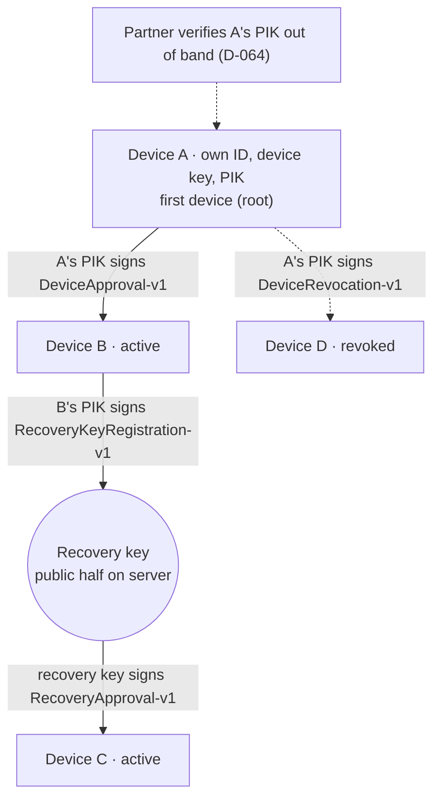
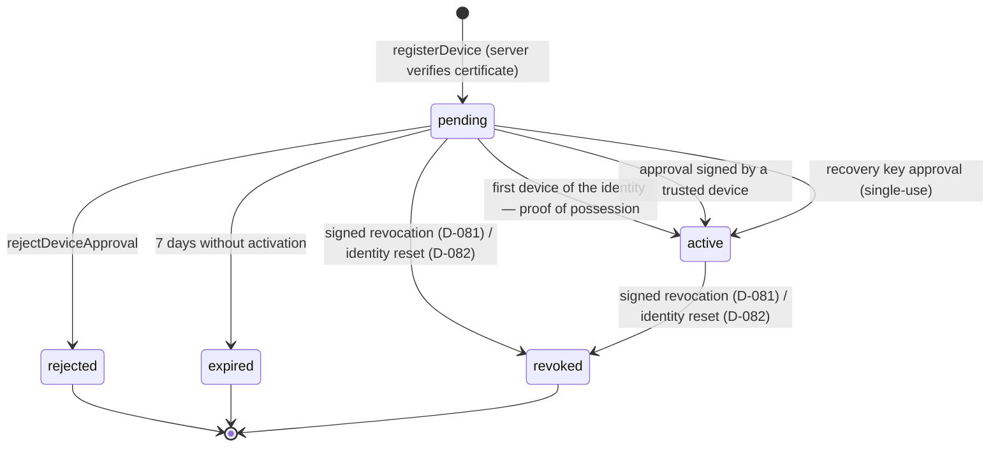
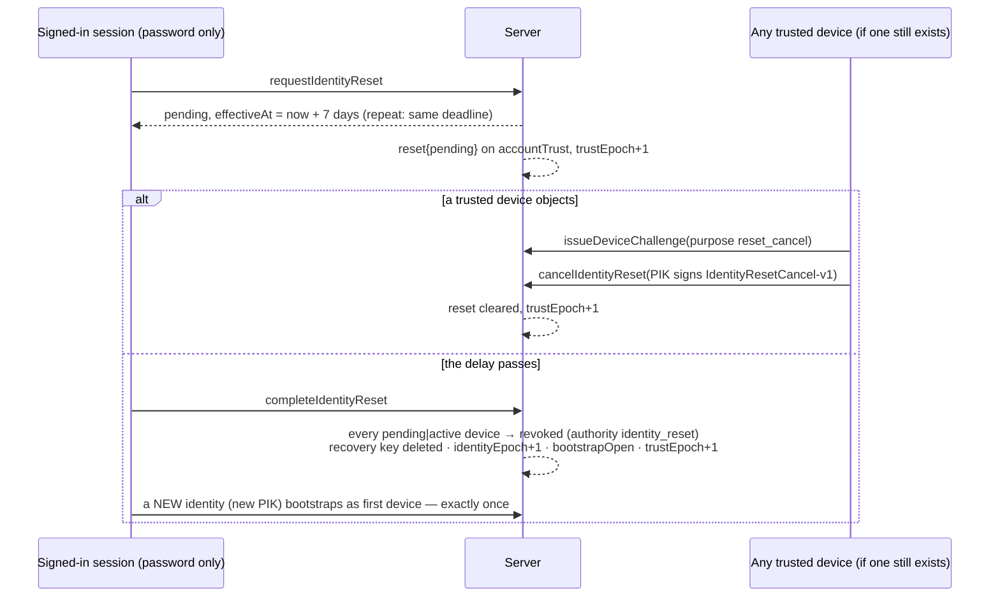

# Multi-Device Trust, Revocation and Recovery

Status: **Security foundation implemented (Prompts 08–09). Sirf Hum is NOT
production E2EE yet.**

- Nothing here has been independently reviewed (§15).
- No UI uses it yet. Since Prompt 10 the development messaging service
  applies verified lineage to MLS membership (§11, D-085).
- The server half runs only in the emulator. Deployment is **BLOCKED**
  until the Blaze plan allows Cloud Functions (D-025); billing has not been
  enabled.

Builds on [DEVICE-IDENTITY](DEVICE-IDENTITY.md). Decisions: D-074–D-084
(and D-085 for the trust unit) in the
[Decision Log](../decisions/DECISION-LOG.md).

## 1. Trust model

| Term | Meaning | Established by |
| --- | --- | --- |
| **Account** | A signed-in Sirf Hum user (Firebase Auth) | Firebase Auth. Grants server *access*, **never** device trust |
| **Device** | One installation's identity for one account: its own device ID, device key and PIK (D-074) | Created locally in the Rust core |
| **Trusted device** | A device whose server record is `active` **and** that the account's signed lineage proves (§11) | Only: the identity's **first** device's proof of possession, approval by a trusted device, or the recovery key |
| **Revoked device** | A device whose record is `revoked` (or `rejected`/`expired` before it was ever trusted) | A trusted device's **signed** revocation (D-081) or a completed identity reset (D-082). Terminal |

**Firebase Auth ≠ device trust.**
- Someone who knows the password can sign in and register a *pending*
  device, but it stays pending: activating it needs a signature by a key
  they do not have.
- Proof of possession alone activates a device only when the account's
  current identity has **no** first device yet: once ever, or once after a
  completed identity reset (§9).
- A password alone can no longer revoke devices (D-081 supersedes D-080's
  session revocation). It can only *request* an identity reset, which is
  delayed and cancellable (§9).

## 2. Multi-device model (D-074)



- **No private key is ever shared, copied or transferred between devices.**
  Every device has independent key material, lifecycle and revocation.
- **Trust between a person's devices is a chain of signed statements:**
  A's PIK signed "B is mine". It is not a shared secret.
- **Approving extends local trust:** the approving device also trusts the
  new device's **exact certificate** (not its PIK on its own, D-085), so it
  can add the new device to MLS groups (tested).

### PIK options evaluated (Prompt 08 §6)

| Option | Verdict | Why |
| --- | --- | --- |
| **A.** Independent PIK per device, no link | Rejected alone | Each device would be an unrelated identity: no way to prove two devices belong to one person, and a partner would have to verify every device separately with no chain |
| **B.** Transfer the PIK private key to new devices (Prompt 04, D-045) | **Rejected** | Prompt 08 §4 forbids reusing private keys across devices. One device's compromise would compromise every device's identity. It also needs a new encrypted transfer channel |
| **C.** Independent PIK per device + a signed authorization artifact | **Selected** | No key leaves any device. It reuses the D-064 certificate unchanged and is verifiable by the server and by peers (§11). Revocation is per device |

D-064 is unchanged. D-045's PIK-transfer recommendation is superseded by
D-074.

## 3. Device lifecycle



- **Stored device states:** `pending`, `active`, `revoked`, `rejected`,
  `expired`. The last three are terminal.
- **Request states:** `open` → `proven`, then deleted on first use.
- **Client-side states** (`DeviceRegistrationFlow.enroll`):
  `EnrollmentActive`, `EnrollmentAwaitingApproval(request, code)`,
  `EnrollmentTerminal(status)`.

**Never:**
- revoked/rejected/expired → anything. Records are never deleted, and
  device IDs and keys are indexed forever (an identity reset does not
  free them either).
- A second bootstrap for the same identity.
- A client write: the rules deny every write to device records and to
  `accountTrust` (Prompt 09 §11).

A reinstall is a new device.

### Transition matrix (Prompt 09 §8)

Every row is enforced by the server in one Firestore transaction and
tested (`functions/test/emulator/*.test.mjs`; "rules" = `firebase/tests`).

| From → to | Actor | Required proof / state | Test |
| --- | --- | --- | --- |
| none → pending | `registerDevice` | valid PIK-signed certificate; new ID and key; < 3 pending; rate limit | registration, `concurrent registrations never exceed the pending cap` |
| pending → active (bootstrap) | `activateDevice` | device proof (purpose 1) on a single-use challenge; identity has no first device (`!trust.exists` or `bootstrapOpen`) | `two first devices bootstrapping at once: only one becomes the root` |
| pending → active (approval) | `approveDevice` | proven request; approver `active` at submission; DeviceApproval-v1 verifies against the approver's stored certificate | `two simultaneous approvals … exactly one wins` |
| pending → active (recovery) | `recoverDevice` | proven request; registered recovery key; RecoveryApproval-v1 verifies; key deleted | `two recovery attempts with one single-use key: one wins` |
| pending → rejected | `rejectDeviceApproval` | open or proven request | `approval after rejection … fail` |
| pending → expired | lazy check / cleanup | deadline passed | `approval after … expiry` |
| pending\|active → revoked | `revokeDevice` | revoker `active`; revocation challenge bound to the revoker; DeviceRevocation-v1 verifies | `a trusted device revokes another`, `self-revocation` |
| pending\|active → revoked (reset) | `completeIdentityReset` | reset pending and its delay passed | `completing revokes every live device` |
| rejected\|expired\|revoked → any | — | **impossible** | rules: `rejected and expired records can never change`, `revocation cannot be reversed`; emulator: `revoking twice fails` |
| any → any by client write | — | **impossible** | rules: `D-081: even the owner cannot revoke by a direct write`, `no shape of revocation write is accepted` |

## 4. Approval handshake (D-075)

```mermaid
sequenceDiagram
    participant B as New device B (pending)
    participant S as Server (Functions)
    participant A as Trusted device A
    B->>S: registerDevice(certificate)
    S-->>B: pending (7-day deadline)
    B->>S: requestDeviceApproval
    S-->>B: requestId, challenge[32], expiresAt (+10 min)
    B->>S: proveDeviceEnrollment(device proof, purpose 2)
    S-->>S: request → proven
    A->>S: listDeviceApprovalRequests
    S-->>A: B's certificate, challenge
    Note over A,B: both show code(B cert, challenge); the user compares
    A->>A: refresh trust epoch + own status (must be active)
    A->>S: approveDevice(A's PIK signs DeviceApproval-v1)
    S-->>S: one transaction: A active now · B pending · verify vs A's STORED cert<br/>→ B active, evidence stored, trustEpoch+1, request deleted
```

**Approval statement** (signed by the approver's PIK; Ed25519 via the
OpenMLS provider and `node:crypto`):

```text
"SirfHum-DeviceApproval-v1" | protocol version u8 = 1 | u32 len | account id
| approver device id[16] | u32 len | approver certificate
| new device id[16] | u32 len | new certificate
| challenge[32] | expires_at u64 BE (whole seconds)
```

| Binding | Prevents |
| --- | --- |
| Account | Account confusion; replay into another account |
| Approver ID and certificate (checked against the server's stored record) | Approval by an untrusted or different device |
| New device ID and certificate | Device substitution; approving the wrong device |
| Single-use server challenge | Replay and forwarding (each request is deleted on first use) |
| Expiry (server-chosen, signed) | Late use; the server also checks its clock |
| Domain string and version | Cross-protocol reuse: a device proof, certificate, recovery, revocation or reset statement, or an MLS signature is never accepted as an approval (tested); a version-2 header is refused (tested) |

**Comparison code:**
- **What it is:** a six-digit code, `SHA-256("SirfHum-ApprovalCode-v1" |
  len | new certificate | challenge)[0..4] mod 10⁶`.
- **Who shows it:** both devices. The user approves only the request whose
  code matches the new device's screen.
- **What it stops:** an attacker with the account password registering
  their own pending device and hoping the owner taps "approve".
- **What it is not:** a secret. It is a short authentication string.
- **Guessing:** matching a code takes ~10⁶ rate-limited, server-issued
  requests.

## 5. Security-layer API (for a future UI)

`DeviceRegistrationFlow.enroll`, and `DeviceTrustService`:

- `pendingApprovals` (with codes), `approve`, `reject`;
- `revoke(deviceIdHex, reason)`: signed by this device (D-081);
- `devices`, `refreshStatus`, `refreshTrustState` (records the trust epoch,
  D-083), `verifyLineage` (D-084);
- `createRecoveryKey`, `recover`;
- `requestIdentityReset`, `cancelIdentityReset`, `completeIdentityReset`
  (D-082).

All return typed states, `DeviceRegistryException(DeviceRegistryFailure)`
or `CryptoException(CryptoErrorCode)` categories, so the UI never handles
cryptography. Before approving, revoking, cancelling a reset or creating a
recovery key, a device refreshes the trust epoch and re-reads its own
server status.

## 6. Signed revocation (D-081)

```mermaid
sequenceDiagram
    participant A as Trusted device A
    participant S as Server
    A->>A: refresh trust epoch + own status (must be active)
    A->>S: issueDeviceChallenge(purpose revocation)
    S-->>A: challengeId, challenge[32], expiresAt (+5 min; bound to A)
    A->>A: A's PIK signs DeviceRevocation-v1(target cert, reason)
    A->>S: revokeDevice(target, reason, challengeId, signature)
    S-->>S: one transaction: challenge live & bound to A · A active ·<br/>target pending|active · verify vs STORED certificates<br/>→ target revoked + evidence, trustEpoch+1, challenge consumed
```

**Revocation statement:**

```text
"SirfHum-DeviceRevocation-v1" | version 1 | u32 len | account id
| revoker id[16] | u32 len | revoker certificate
| revoked id[16] | u32 len | revoked certificate
| reason u8 (1 removed · 2 lost · 3 stolen · 4 compromised)
| challenge[32] | expires_at u64 BE
```

- **Who:** any `active` device of the account, including the device itself
  (self-revocation, e.g. before handing a phone on).
- **Why signed:** attribution (which device revoked which) and peer
  verification (§11). A password alone can no longer revoke. (A password
  holder can still fill the pending-device cap or request a reset; both
  are bounded denials of service, never a trust gain.)
- **Stored evidence:** the record keeps `revocation{protocolVersion,
  authority: 'device', revokerDeviceId, revokerCertificate, reason,
  challenge, expiresAtUnix, signature}`, `revokedReason` (the name) and
  `revokedEpoch`. Peers re-verify it.
- **Refused:** a revoked, pending or foreign revoker (`approver_not_trusted`
  at challenge issue and submission), a forged or wrong-account statement
  (`revocation_invalid`, counted in the failure budget), a replayed
  challenge (`challenge_invalid`), an already-terminal target
  (`device_not_pending`), an unknown reason (`invalid_argument`).
- **No cascade:** revoking B does not revoke devices B approved earlier;
  they were legitimately approved while B was trusted. The stored lineage
  lets the owner review and revoke them, e.g. when B was compromised.
- **What a revoked device cannot do:** reactivate itself; be re-registered;
  approve, revoke, register a recovery key or cancel a reset (the server
  checks `active` at submission); use an approval it signed before
  revocation.
- **Race with an approval** (tested): the transactions serialize. Either
  the approval committed first (its `activatedEpoch` is lower than the
  approver's `revokedEpoch`, so the lineage stays valid) or it is refused.
- **MLS (Prompt 10):** peers apply the signed revocation through lineage
  (`trustLineage`), which revokes the device **and its PIK** (D-085). From
  then on its messages are rejected and senders refuse to encrypt to a
  roster that still holds it; any member device removes it with a staged
  Remove commit (E2EE-MESSAGING-DESIGN §9).

**Residual risk (accepted, documented):** when the **only** device is
stolen and there is no recovery key, nothing can sign its revocation. The
user's paths are the identity reset (§9), which the thief's device could
cancel if it is unlocked and still signed in, and Firebase session
revocation (account access only). This is why the device UI must strongly
recommend a recovery key: with one, the user recovers a new device
immediately and revokes the stolen one.

## 7. Revoked-device behaviour and offline devices

**Local data deletion ≠ cryptographic revocation.**
- **Revocation** is a server fact, backed by signed evidence: the device is
  no longer trusted, and peers will remove it from MLS groups.
- **Deletion** is the local wipe of the device's slot (store key first,
  then state).

Revocation does not wipe the device remotely. A thief's offline copy stays
on the thief's device.

When a device learns it is revoked (`refreshStatus` returns a terminal
status):
1. It stops presenting itself as trusted. Trust operations refuse locally
   (`deviceNotTrusted`), and the server refuses them anyway.
2. Pending operations are dropped. Cached server metadata is ignored in
   favour of the server's status.
3. The local identity is **not** wiped automatically. Already-received
   content remains readable on that device, which is inherent: E2EE cannot
   recall plaintext. The app offers "remove this account from this device"
   (crypto-erasure) and, if the user wants the phone back, enrolling as a
   **new** device.

**Offline:** while a device is offline, nothing tells it that it was
revoked. The server is authoritative, and every trust-changing call checks
the actor's status at submission. An offline device that reconnects cannot
create server-authorized trust and sees its revoked status on the next read
(tested).

## 8. Recovery (D-076)

```mermaid
sequenceDiagram
    participant T as Trusted device B
    participant S as Server
    participant N as New device C
    T->>S: issueDeviceChallenge(purpose recovery_registration)
    T->>T: Rust generates seed; B's PIK signs RecoveryKeyRegistration-v1
    T->>S: registerRecoveryKey(public half, signature)
    S-->>S: store public key + registration evidence, trustEpoch+1
    Note over T: SHRK1-… shown ONCE to the user, never stored or sent
    N->>S: register · requestDeviceApproval · proveDeviceEnrollment
    N->>N: user types the key; Rust signs RecoveryApproval-v1, wipes the seed
    N->>S: recoverDevice(signature)
    S-->>S: one transaction: verify · C active + evidence · key DELETED · trustEpoch+1
```

| Option | Verdict |
| --- | --- |
| **A. Device-to-device:** a trusted device approves the new one | **Default** (§4) |
| **B. Self-held recovery key** | **Implemented, optional.** For when every trusted device is lost |
| **C. Server recovery** | **Rejected.** If the server could create device trust, a password compromise would equal a trust compromise |
| **D. Support/admin recovery** | **Rejected** for trust. Support may help with *account* access (Firebase), never with device trust or content |

**Never:** a server master key; server copies of private keys; a plaintext
recovery secret on the server; hidden escrow; support able to decrypt;
"forgot password" restoring E2EE history.

**Recovery key:**
- **Generation:** a 32-byte Ed25519 seed generated **in Rust** on a trusted
  device (`createRecoveryKey`).
- **Export:** exactly once, as text, by explicit user action:
  `SHRK1-XXXX-…`, RFC 4648 base32 of `version | seed | 4-byte typo
  checksum`. The checksum is only for typos; the 256-bit seed carries the
  security.
- **Server side:** only the **public** half, with the registering device's
  PIK-signed statement (kept as lineage evidence). Registering again
  replaces the key.
- **On success:** the server activates the device, stores the full chain
  evidence (registration + recovery approval) on its record and **deletes
  the registered key (single-use)**. Two concurrent recoveries: one wins
  (tested).

**What survives losing all devices:**

| | With a recovery key | Without |
| --- | --- | --- |
| Account access (sign in) | Yes (Firebase) | Yes (Firebase) |
| A new trusted device | **Yes**, immediately | Only through an **identity reset** (§9): a NEW identity after a 7-day delay |
| Message history | **No.** MLS gives new devices no history; an encrypted archive is deferred | No |
| Partner relationship | Continues; the new device is part of the same verified lineage | The partner must **re-verify** the new identity |

## 9. Identity reset (D-082)

For an account whose devices are **all** lost and that has no recovery key.
It does **not** recover the old identity and creates no trust by itself: it
retires the old identity and lets the account start a new one, which every
partner must verify again.



**Options evaluated (Prompt 09 §6):**

| Option | Verdict |
| --- | --- |
| A. Server-only reset on password/session | **Rejected:** a password compromise would become a trust compromise |
| B. Terminal "no recovery" state | Safe, but leaves a legitimate user with no path at all |
| **C. Delayed, cancellable reset to a NEW identity** | **Selected:** the delay gives any surviving device time to cancel with a signature; the result is a new identity that partners must re-verify, so an attacker gains no inherited trust |

**Delay setting (D-159, D-160):** 7 days by default. An environment may set
`SH_IDENTITY_RESET_DELAY_HOURS` to a whole number of hours from 0 to 168;
anything else keeps 7 days. Production uses **0** (owner decision, D-160,
WhatsApp-style): a reinstalled phone re-registers itself as soon as the
account signs in; the partner's phone trusts the new identity automatically
and says "security code changed". With a non-zero delay the app's "Set up
this phone" page offers the recovery key or the waiting reset.

**Cancellation statement:** `"SirfHum-IdentityResetCancel-v1" | version 1 |
len|account | device id[16] | len|certificate | challenge[32] |
expires_at u64`.

**Guarantees (tested):** no reset before trust exists (`reset_unavailable`);
early completion refused (`reset_not_ready`); repeated requests keep the
original deadline; a revoked device cannot cancel; a forged cancel fails;
completion revokes every live device; exactly one new first device; old
IDs and keys stay indexed forever; rate limit 3 per 7 days.

**OPEN before production:** the legitimate user and the partner must
**learn** that a reset was requested. That needs push notifications (no
private content, D-009/D-049), which do not exist yet. Until
then the 7-day window protects only users who open the app. Partner-visible
re-verification also needs the pairing UX.

## 10. Freshness and rollback (D-079, D-083)

**Trust epoch (D-083, implemented):** `accountTrust.trustEpoch` is a
server-side counter, bumped in the same transaction as every trust change
(bootstrap, approval, recovery, recovery-key registration, revocation,
reset request/cancel/complete; not by registration). Each device records
the highest epoch it has seen in its sealed Rust state
(`observeTrustEpoch`, record kind 4) and refuses an older one
(`trust_state_stale`) before acting. This detects a stale cache, a lagging
replica or a rolled-back server view **as seen by a device that already
saw a newer one**. It does not prove the server is honest.

**Local file rollback (D-079): still NOT provided.**

| Option | Assessment |
| --- | --- |
| Counter inside the sealed state (incl. the trust epoch) | Rolled back together with the state |
| Platform monotonic counter | Neither Android Keystore nor iOS Keychain offers a general-purpose app counter |
| Server-held state version | Activity metadata per write plus an offline design. Possible later |
| Hardware attestation (Play Integrity, App Attest) | Narrows tampering; does not prove freshness |

**What does hold:** copied state is useless on another device; restored
state cannot regain *server* trust (status is server-side; IDs and keys are
indexed forever); after a rollback, the next refresh re-learns the current
server epoch; MLS removal still blocks new epochs. **No local rollback
protection is claimed.**

**Prompt 17 analysis** ([audit review §4.3](audit/PROMPT-17-SECURITY-REVIEW.md#43-local-rollback-d-079-exactly-what-happens)):
a restored older copy on the same phone is not detected; it forgets later
revocations and lowers the trust-epoch floors until the next refresh with
the server's current lineage re-learns them (pinned by
`documented_limit_a_restored_older_state_is_not_detected_until_refreshed`);
consumed MLS keys and "deleted for me" history come back; within-epoch
sender-key reuse is mitigated only probabilistically by OpenMLS's
`reuse_guard`. It needs write access to the app's files with the Keystore
usable (T4), never regains server trust, and is classified **P2**:
server-anchored freshness or a written acceptance before public launch.

## 11. Peer-side lineage verification (D-084)

The server stores, on each activated device record, the exact signed
statements that activated it (`approval` or `recovery` evidence, protocol
version 1, `activatedEpoch`), and on each revoked record the signed
revocation (`revocation`, `revokedEpoch`). A device verifies the chain
**itself, in Rust** (`CryptoCore.verifyLineage`, FFI
`sh_crypto_verify_lineage`):

1. The root is the current identity's first device (`accountTrust.
   firstDeviceId`); its certificate must self-verify.
2. Links in activation-epoch order: each approver/registrar must already be
   in the chain (byte-identical certificate); every statement must verify;
   protocol version must be 1; no duplicate device **and no person key
   certifying a second device** (D-122, Prompt 17); expiry not before the
   new certificate's issue time.
3. Signed revocations: the revoker must be in the chain and the statement
   must verify. Server-asserted revocations (identity reset) are honoured
   but can only remove trust.
4. Result: the trusted set. `DeviceTrustService.verifyLineage` **fails
   closed** if the server lists any `active` device the chain does not
   prove.

Wire format, golden vectors and cross-implementation tests:
`native/src/lineage.rs`, `functions/test/vectors/device_trust_v2.json`
(TypeScript generates; Rust and Dart verify the identical blob).

**What this proves and what it does not:**
- **Proves:** every trusted device descends by valid signatures from the
  root; a malicious server cannot add a device to the set.
- **Does not prove** who the root is: that is the partner's out-of-band PIK
  verification (D-064). A malicious server can still **withhold**
  revocations or new links (omission), or order events in a way that does
  not match real time; peers rely on the server for that ordering and for
  freshness, which the trust epoch only partly addresses.

### Trust unit (D-085, Prompt 10)

Verifying the chain is not enough on its own: what a device then
*trusts* matters. Until Prompt 10 the core trusted person keys. Since each
device has its own PIK (D-074) and a PIK can sign any number of
certificates, a revoked device could have certified a new device ID with its
retained PIK. The core now trusts **exact certificates**:

- `trustLineage(lineage, trustEpoch)` verifies the chain in Rust from a
  root whose PIK is an out-of-band **anchor**, then trusts each proven
  certificate for that account;
- signed and server-asserted revocations revoke the device **and its PIK**,
  permanently; a later lineage that omits them cannot undo them;
- each PIK is pinned to the one device ID it certifies;
- the account's previously proven devices that a new lineage no longer
  proves are dropped (server omission removes trust, never adds it);
- an older `trustEpoch` than one already applied for that account is
  refused (`trust_state_stale`).
- a device keeps the account a lineage first proved it for; a lineage that
  would re-label it is refused (a root-only lineage does not itself prove
  its account).

Adversarial tests: `native/src/engine/trust_tests.rs` (forged and re-minted
certificates, revoked PIKs, pins, stale and broken lineage, account
re-labelling, restart, v1 state migration). The server-ordering limit above is kept as a documented
test.

## 12. Rate limits and expiry (D-077, D-078)

Per-account fixed windows, in the server-only `rateLimits` collection
(none loosened in Prompt 09):

| Operation | Limit |
| --- | --- |
| `registerDevice` | 5 per hour, and at most 3 `pending` devices at once (counted inside the transaction) |
| Challenges (activation, recovery registration, revocation, reset cancel) | 10 per hour |
| Approval requests | 5 per hour |
| Verification failures of any kind | 5 per hour, then every verifying call is refused for the window |
| Recovery attempts | 3 per day |
| Signed revocations | 10 per hour |
| Identity reset request/complete | 3 per 7 days |

Boundary tests: exactly the limit passes, one over is refused, a new window
resets, concurrent attempts never exceed a limit, limits are per account.
They never become an enumeration oracle (own account only, generic
`rate_limited`).

**Lifetimes:** challenges 5 minutes; approval requests 10 minutes; pending
devices 7 days, then `expired` (kept forever); identity reset delay 7 days.
`cleanupExpiredDeviceRecords` runs daily (needs Cloud Scheduler, i.e.
Blaze); expiry is also enforced lazily on every call.

## 13. Server authority

**The server decides:** registration status, activation, the execution of
revocations and resets, approval validity, expiry, rate limits and the
trust epoch. It derives all of them itself; no client-supplied security
state is trusted.

**The server cannot:** sign an approval, recovery approval, revocation,
reset cancellation or device proof (it has no private key); decrypt
anything (no content keys, no master key).

**A malicious server could still:** refuse service; lie about status;
withhold evidence; complete a reset nobody requested (the result is a new,
unverified identity, visible to partners as such; no inherited trust).
Peers verify certificates, PIKs and lineage themselves (§11, D-057).

**Rules and callable re-audit (Prompt 09 §11):**

| Path / callable | Finding | Result |
| --- | --- | --- |
| `users/{uid}/devices/*` | The owner's revoke update was the last client write | **Removed**: `allow write: if false` (D-081) |
| `accountTrust/{uid}` | Server-only; clients need the epoch and reset state | Owner read only; every write denied (tested: no epoch rollback, bootstrap reopen or fake reset) |
| Challenges, requests, indexes, `rateLimits` | Server-only | Unreachable from clients (tested) |
| `listDeviceApprovalRequests`, `rejectDeviceApproval` | Any signed-in session of the account may call them | Accepted: they expose only public material, and rejecting is a denial of service a password holder could cause anyway; never a trust gain. **Prompt 17 (P17-07):** re-classified P2: rejection should need a device proof and a rate limit, in line with D-081 |
| `registerDevice` → `duplicate_device` | Reveals that a device ID or key is already indexed somewhere | Low risk: IDs are 128-bit random and keys are public; rate-limited per account. Recorded, not changed |
| Every callable | Account from the verified auth context only; App Check enforced; category-only errors; state derived server-side in transactions | No client-supplied security state is trusted |

## 14. Observability

- **Logged:** event names and coarse categories only, e.g.
  `device_revoked outcome=revoked`, `device_lineage_verified
  outcome=mismatch`, `trust_state_refreshed outcome=stale`, server
  `device_revoked outcome=revocation_invalid`.
- **Never logged:** recovery keys, seeds, challenges, signatures, codes,
  certificates, device IDs or account IDs. Client tests assert IDs, codes,
  request and challenge IDs never appear; a server test statically checks
  every Functions logger call carries only an event and an outcome.

## 15. Independent review required (not done)

None of this is independently audited. Review is needed before any
production claim for: the approval, revocation and reset-cancel statements
and comparison code; the recovery design and key format; the identity
reset design; lineage verification and its wire format; the trust epoch;
the platform secure storage adapters; the rollback analysis; the server
Functions; the Firebase Rules.

## 16. Open / next

- **Deployment BLOCKED:** Functions and the cleanup schedule need Blaze
  (D-025); billing is not enabled.
- **Reset notifications** (push, no private content) before production
  (§9).
- **Local rollback protection** (D-079).
- ~~Lineage in messaging~~: done in Prompt 10 (`trustLineage`, D-085).
- **Own-account root anchoring** for non-root devices needs a verification
  UX (D-085 open).
- **Device-management UI** (Prompt 09 excluded it).

## 17. Prompt 17B changes

- **Rejection** (`rejectDeviceApproval`) needs an active device's proof,
  purpose `approval_rejection` = 6, over a challenge bound to the request
  (D-129). A password alone can no longer block new devices.
- **Reset alerts** (D-132) close the D-082 "OPEN before production" item in
  code; they need deployment (Eventarc).
- **Revocations always reach peers:** when an account's lineage cannot be
  applied (e.g. a reset to an identity not yet verified), every device the
  server reports `revoked` is revoked locally (D-128). Revocation only
  removes trust, so this is safe against a lying server.
- **Partner verification** anchors the partner's root only after an explicit
  comparison (D-128); a non-root device anchors its own account's root from
  a lineage that proves the device itself.
